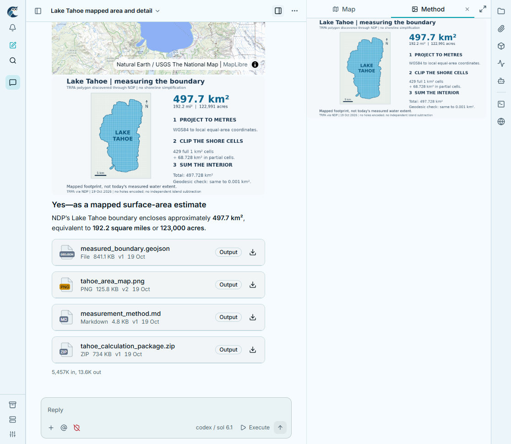
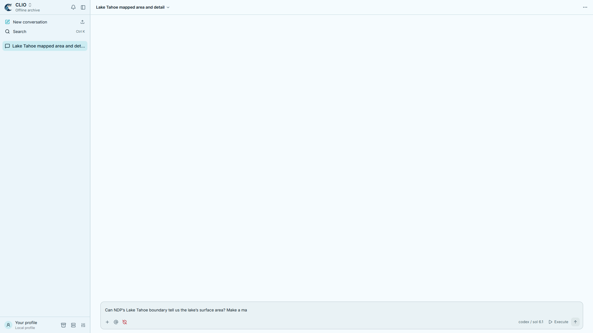
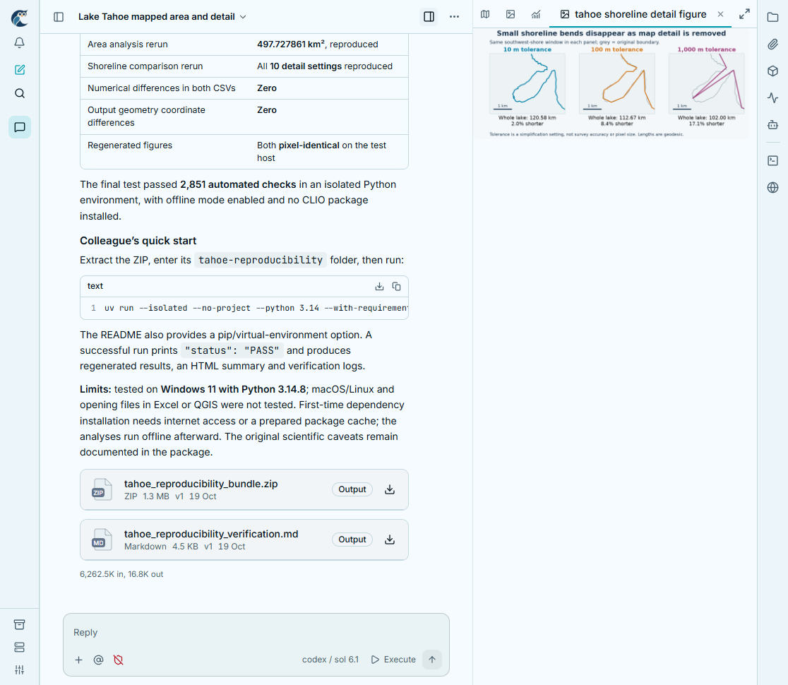

# Current adapter verification

## Corrective visual pass — 2026-11-12

The previous compatibility review below was **not visual acceptance**. The user
rejected its warm palette, overlapping collapsed sidebar, abbreviated navigation,
missing composer buttons and clipped boundaries. These are framework defects,
not artistic choices for a later film.

Corrections in this pass:

- Native **Cool** light palette by default, with the other native palettes available
  in the preview. The earlier forced `light` ID selected RC1's warm palette.
- `Sidebar contained` and native navigation header/footer. Removed the stage
  transform workaround. The owl, collapse, new/import, search, notification and
  footer controls retain their source layout when the sidebar folds.
- Correct application-shell body/height containment; the whole document no longer
  scrolls alongside the conversation. The external preview toolbar also contains
  long titles.
- Complete native composer context/reference and behavior controls, readable
  offline editing, source approval/mode, and archive-only submission semantics.
- Full native right-edge launcher strip, image/map/chart tab icons, keyboard tabs
  and a maximize action outside the tablist. Maximize uses the native workspace
  host and leaves navigation visible. Crowded inactive tabs compact to native
  format icons, preserving the active name; the full four-result screenshot
  exposed unreadable fragments despite passing bounds checks. Backward seeks
  also clear opened artifacts.
- No invented live connection: the header explicitly says offline archive rather
  than animating a reconnection loop. Uncaptured terminal/browser actions show a
  notice instead of incorrectly opening Files.
- Removed Tahoe's redundant fallback-map caption that collided with native
  attribution. Scientific layers and map attribution remain.
- The cached Tahoe map style is also gated by the loaded scene, so another
  manifest cannot inherit Tahoe imagery merely by using the default preview URL.
- The full encoded scan found a genuine one-frame workspace collapse at source
  frame **1690** (28.17s). Asset-only readiness had not rejected a stable thumbnail
  inside a 150px shell. Render mode now uses explicit host viewport dimensions
  and validates whole-shell/navigation/composer geometry before acknowledgement.
  A regression injects a temporary 150px stage and requires recovery before ready.
  Frames **1688–1692** are regenerated through that corrected renderer and
  conformed at their exact source positions, retaining the original movie and
  hashes. The completed conformed file is decoded/scanned again.

The new browser layout matrix checks 1920×1080, 1280×720, 1116×970 and 900×700.
It measures visible controls, covering/overflow, sidebar/header separation,
composer containment, both light palettes and long titles after layout settles.
Native-source checks and the integration test still cover real saved maps, images,
the full chart/table, tools, backwards seeking and artifact inspection. Screenshot
review found the map-caption collision after the initial geometry pass; tests
alone did not find it. Local review images are in
`motion/.native-ui/current-layout-review/`.

Saved visual evidence:

The corrected production preview is the framework baseline. The replacement is
`motion/out/current-ui/tahoe-current-rc1-light-v2.mp4`: 40 seconds, 1920×1080,
60fps, H.264/yuv420p, BT.709, silent. SHA256:
`d5bee03cf89104012a85fd40b76483611768ca3a88710f01772a302fb1c560d3`.
All 2,400 conformed frames pass full decode; the final all-frame scan has zero
isolated-flash candidates. The repaired frame and both conform boundaries were
inspected at full resolution. Encoded contact sheets sample the entire timeline
at 4fps; sheets 2, 4, 6 and 8 plus the handoff frames were inspected. This does
not claim a full subjective normal-speed viewing of the encoded delivery.

**143 motion tests, both production-browser suites, motion/native typechecks,
production build and formatting pass without skips.** [review.json](review.json)
records the source, viewport matrix, capture/base/patch/conform hashes and exact
review scope. The movie and hashes below describe the **superseded warm-layout
encode**. This remains a single-session compatibility story; it does not port
paired SPOTTER choreography or establish new marketing pacing.

## Previous compatibility receipt (superseded appearance)

Target: `iowarp/gact-tui` rc1/ui-liftoff at
`47b74250e512358dda6275cd5084e9d4a8d1a376`.

Source: `tahoe.native.json`, original archive SHA256
`e5f762a73eaa749738780b095a24133cec08d8d125c81bd24ecfc8c3bda0dbf4`,
session `sess_9cca40f4085e`. No scientific work is re-executed by this test.

## Findings addressed

- Fixed left navigation overlapping external preview controls by giving the
  native stage its own fixed-position containing block.
- Follow-scroll now accounts for rich results resizing after their block arrives.
- Corrected native provider/import contracts, including conversation display,
  router, HDF5 viewer build and the redesigned composer editor.
- Tab closing now removes the selected view. Backward seeks clear later pocket
  state. Native maximize restores to the conversation.
- Frame readiness checks native surface/image/map paint and settled layout.
  It does not confuse a running activity's busy state with an asset loader.
- Historical profiles keep their complete typecheck entry lists and source pins.
- A real preview Play check exposed a negative first frame caused by mixing
  `performance.now()` and the animation callback timestamp. Preview playback now
  establishes its epoch from the first vsync callback and clamps early ticks.
  Direct renderer seeks were unaffected. Normal Play/Pause now has browser
  coverage as well as the absolute-frame checks.

## Coverage

Pure projection/manifest tests check source order, immutable evidence, tool
completion visibility, source-linked pockets, Unicode-safe streaming, new-scene
manifest initialization and invalid inputs. Production-browser checks exercise
the actual native components and captured dependencies, not mocked UI.

Rendered `motion/out/current-ui/tahoe-current.mp4`: 40 seconds, 1920×1080,
60fps, H.264/yuv420p, BT.709, silent. All **2,400 frames** decoded successfully.
SHA256: `13ca50034816afe037fc507c4d8f77fdb36d5b62fc2347c38c9f8e9f9dde8a63`.
The low-resolution all-frame temporal scan found zero isolated-flash candidates;
that heuristic alone does not establish visual correctness.

Inspected encoded frames 100, 190, 370, 500, 700, 900, 1150, 1300 and 2399;
consecutive ranges 203–208, 1043–1048 and 1241–1246 cover tool completion,
pocket arrival and answer/view handoff. Maps have their actual geographic
background; figures paint; the transcript is readable at native size; no label
leakage, blank results or isolated paint flashes appeared in those inspections.
The normal preview completed 0–2399 in the in-app browser after the clock fix.
Native artifact opening was also checked: the saved PNG decoded in the complete
production workbench, with its current file toolbar and strip.

**140 motion tests, 134 Python tests and the production-browser integration
passed, without skips.** Motion/native/legacy typechecks, formatting, Ruff and
pyright passed. See [review.json](review.json) for machine-readable coverage and
the separate capture/final-preview HTML hashes. The capture preceded the final
preview-only clock/error-reporting fixes; those fixes were separately tested in
the final production adapter.

A high-resolution check of frame 190 found an elapsed-time defect that the
contact sheet missed: `593h` was the archive's age, computed by the native live
clock from its historical start timestamp. The replay now supplies captured
execution time through the presentation clock hook. The five active-tool ranges
(154 frames total) were re-rendered and conformed, with exact source-frame
mapping and input/output hashes in the adjacent `.clock-repair.json` receipt.
The corrected frame shows `0.7s`. The final conform passed the complete decode,
2,400-frame count and flash scan again. The original is retained under the local
output's `review/` folder. A same-frame browser test and unit clock assertions
cover the regression. Fresh renders use the corrected clock throughout.

The three-turn compatibility fixture also passed after explicitly opening the
earlier shoreline view: the production UI virtualizes offscreen transcript rows.
Its chart and all ten captured comparison rows rendered in the pocket. This
distinguishes an inactive/unmounted view from a lost or failed artifact.

Paired SPOTTER, attention, Science Log and mesh-film choreography remain on their
historical profiles. This check does not claim those films have been migrated.

This is a framework compatibility check, not an approved new marketing edit.
The sample retains output cards to exercise file presentation. Native pane
reflow/activity folding is immediate; a new authored smoothing/camera/pointer
pass has not been done. Encoded review consists of the samples and consecutive
ranges above plus the full-frame scan; no full subjective end-to-end playback
review is claimed. Use this adapter as the source-fidelity baseline and remeasure
the choreography when porting a finished film.

Automatic approval review rejected deletion of the owned previous compiled build
with only `blocked by policy`. `.native-ui/build-current-previous` remains on D:;
original exports and the active source checkout were not cleanup targets.
